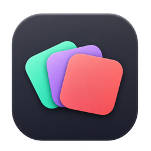
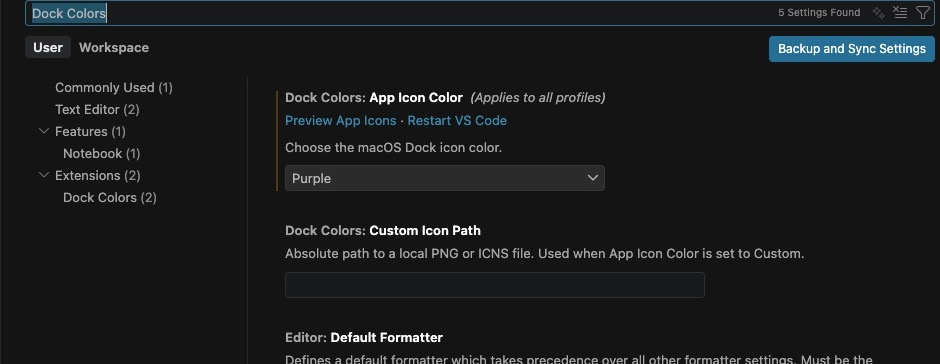

<p align="center"></p>

# Dock Colors

Give your **VS Code Dock icon** a new look on macOS. Choose from **28 built-in icons** across original and black backgrounds, or use a PNG or ICNS of your own.

[Install from Marketplace](https://marketplace.visualstudio.com/items?itemName=dock-colors.vscode-dock-colors) · [Download a VSIX](https://github.com/chenyao0910/vscode-dock-colors/releases/latest) · [Source on GitHub](https://github.com/chenyao0910/vscode-dock-colors) · [Try the colors](https://chenyao0910.github.io/vscode-dock-colors/)

| Lavender | Coral | Mint | Gold | Indigo | Sky |
| :---: | :---: | :---: | :---: | :---: | :---: |
|  |  |  |  |  |  |

## Install

Dock Colors supports **Visual Studio Code Stable on macOS**, on Apple Silicon and Intel. Install from the Marketplace, or download `darwin-arm64` for Apple Silicon or `darwin-x64` for Intel from [GitHub Releases](https://github.com/chenyao0910/vscode-dock-colors/releases/latest). Run **Extensions: Install from VSIX...** to install the downloaded package.

## Pick your icon

1. Open the Command Palette with `⇧⌘P` and run **Dock Colors: Preview App Icons**.
2. Click an icon to apply it. You can also change the selection in **Settings → Dock Colors → App Icon Color**.
3. If the Dock still shows the previous icon, use **Restart VS Code**.



To use your own image, fill **Custom Icon Path** with the absolute path to a local PNG or ICNS, then choose **Custom**. Choose **Default** to restore the original VS Code icon before uninstalling.

Dock Colors uses the macOS custom app icon mechanism and needs write access to your VS Code app bundle.

## Develop locally

Build the helper with `swiftc set-icon.swift -o set-icon`, then open this folder in VS Code and press `F5` to launch the Extension Development Host.

## Distribution

Build a Universal Binary with Xcode Command Line Tools:

```sh
build_dir=$(mktemp -d)
swiftc -target arm64-apple-macos11.0 set-icon.swift -o "$build_dir/arm64"
swiftc -target x86_64-apple-macos11.0 set-icon.swift -o "$build_dir/x86_64"
lipo -create "$build_dir/arm64" "$build_dir/x86_64" -output set-icon
lipo -archs set-icon
```

Package from a clean staging directory containing only `package.json`,
`extension.js`, `set-icon`, `icon.png`, and `README.md`. Use
`npx @vscode/vsce package --target darwin-arm64` for Apple Silicon and
`npx @vscode/vsce package --target darwin-x64` for Intel. The same universal
helper can be used in both packages. The VSIX files can be attached to a
GitHub Release or uploaded to Visual Studio Marketplace under your publisher ID.
